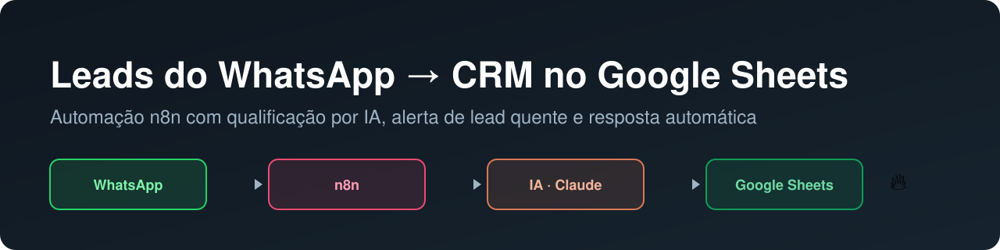
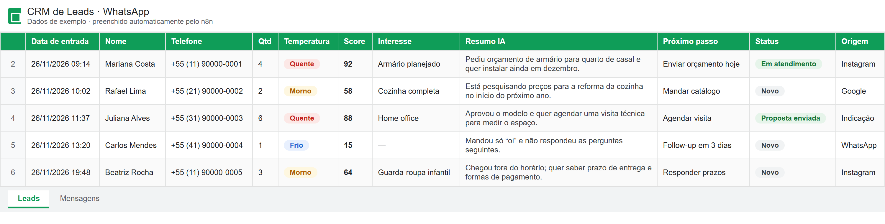
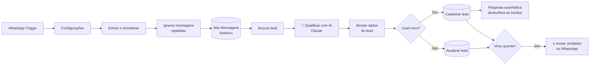
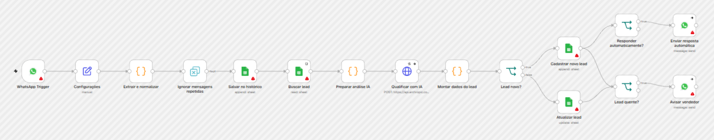

<p align="center">
  
</p>

<p align="center">
  
  
  
  
  
</p>

<p align="center">
  <b>Toda conversa no WhatsApp vira um lead organizado, qualificado por IA e pronto para o time de vendas.</b><br>
  Sem digitar nada, sem perder contato e sem lead quente esquecido.
</p>

---

## 🎯 O problema

Pequenas empresas recebem dezenas de mensagens por dia no WhatsApp, e os leads se perdem no meio das conversas. Ninguém anota quem chamou, o vendedor não sabe quem está pronto para comprar e quem chama fora do horário fica sem resposta.

## ✅ A solução

Um fluxo no **n8n** que escuta o WhatsApp da empresa e, para cada mensagem:

1. **Registra** o contato e a conversa num CRM no Google Sheets.
2. **Qualifica com IA (Claude):** temperatura, score de 0 a 100, interesse, resumo e próximo passo.
3. **Responde na hora**, com uma mensagem para dentro e outra para fora do horário comercial.
4. **Avisa o vendedor** no WhatsApp assim que um lead fica quente.

## 📊 Resultado

<p align="center">
  
  <br><sub>Exemplo com dados fictícios da aba <code>Leads</code>, preenchida automaticamente pelo fluxo.</sub>
</p>

## ⚙️ Como funciona



<p align="center">
  
  <br><sub>O fluxo v2 PRO no editor do n8n: 16 nós, da mensagem recebida ao alerta para o vendedor.</sub>
</p>

## ✨ Recursos

| Recurso | Como funciona |
|---|---|
| 🤖 **Qualificação por IA** | O Claude lê cada mensagem e preenche **temperatura**, **score**, **interesse**, **resumo da conversa**, **próximo passo** e **origem** (Instagram, Google, indicação…). |
| 🔥 **Alerta de lead quente** | O vendedor recebe no WhatsApp um resumo e o link para responder. O alerta sai só quando o lead *vira* quente, sem repetir. |
| 💬 **Resposta automática** | Boas-vindas para leads novos, com texto diferente fora do horário comercial. |
| 🗂️ **Histórico completo** | Todas as mensagens ficam salvas na aba `Mensagens`. |
| ♻️ **Sem duplicatas** | Um lead por contato, e reenvios de webhook da Meta são ignorados. |
| ✋ **Respeita o time** | O fluxo não altera os campos **Status**, **Responsável** e **Observações**. |
| 🛡️ **Resiliente** | A chamada à IA é refeita se falhar. Se falhar de novo, o lead é salvo como `A classificar`, sem perder dados, e um fluxo de erro avisa no WhatsApp. |
| ⚙️ **Configuração central** | Planilha, empresa, horário e textos ficam num único nó. |

## 📁 Estrutura

```
n8n-leads-whatsapp/
├── workflow/
│   ├── leads-whatsapp-v2-pro.json          # fluxo principal (v2)
│   ├── alerta-de-erros.json                # avisa no WhatsApp quando algo quebra
│   └── leads-whatsapp-google-sheets.json   # v1, versão simples sem IA
├── planilha/                               # cabeçalhos das abas Leads e Mensagens
└── docs/images/                            # imagens do README
```

## 🚀 Instalação

<details>
<summary><b>Passo a passo completo</b> (clique para abrir)</summary>

### 1. Planilha
Crie uma planilha no Google Sheets com duas abas e cole os cabeçalhos:

- **`Leads`** ([modelo](planilha/v2-aba-Leads.csv)): ID, Data de entrada, Nome, Telefone, WhatsApp ID, Primeira mensagem, Última mensagem, Última interação, Qtd mensagens, Temperatura, Score, Interesse, Resumo IA, Próximo passo, Status, Origem, Responsável, Observações, Link WhatsApp
- **`Mensagens`** ([modelo](planilha/v2-aba-Mensagens.csv)): Data, WhatsApp ID, Nome, Tipo, Mensagem, Message ID

Dica: transforme **Status** em lista suspensa (`Novo`, `Em atendimento`, `Proposta enviada`, `Fechado`, `Perdido`) e use cores condicionais na coluna **Temperatura**.

### 2. Importar no n8n
*Workflows → Import from File* → importe `leads-whatsapp-v2-pro.json` e `alerta-de-erros.json`.

### 3. Credenciais
| Credencial | Onde |
|---|---|
| WhatsApp OAuth / WhatsApp API | Trigger e nós de envio ([Meta for Developers](https://developers.facebook.com/docs/whatsapp/cloud-api)) |
| Google Sheets OAuth2 | Os 4 nós da planilha |
| Anthropic | Nó *Qualificar com IA* ([console.anthropic.com](https://console.anthropic.com)) |

### 4. Nó `Configurações`
| Campo | Exemplo |
|---|---|
| `planilhaId` | trecho da URL entre `/d/` e `/edit` |
| `nomeEmpresa` / `descricaoNegocio` | dizem à IA o que conta como um bom lead |
| `whatsappVendedor` | `5511999999999` |
| `diasAtendimento` | `1,2,3,4,5` (1 = segunda … 7 = domingo) |
| `horaInicio` / `horaFim` | `9` / `18` |
| `respostaAutomatica` | `true` / `false` |
| `msgBoasVindas` / `msgForaHorario` | `{nome}` vira o primeiro nome do lead |
| `modeloIA` | `claude-haiku-5-5` |

### 5. Alerta de erros
No fluxo de erros, preencha o seu número e o *Phone Number ID*. Depois, no fluxo v2, vá em *Settings → Error workflow* e escolha **Alerta de erros (WhatsApp)**.

### 6. Ativar
Ative o fluxo. O n8n precisa estar acessível por **HTTPS** público para receber o webhook da Meta. Se ele roda localmente no Docker, use Cloudflare Tunnel ou ngrok.

> ⚠️ **Regra das 24h da Meta:** só dá para mandar texto livre para quem falou com o número da empresa nas últimas 24h. Para o alerta ao vendedor chegar sempre, use um **template aprovado** ou troque o canal por e-mail ou Telegram.

</details>

## 🧭 Versões

| | v1 (simples) | v2 PRO |
|---|:---:|:---:|
| Cadastro e atualização de leads | ✅ | ✅ |
| Histórico de mensagens | — | ✅ |
| Qualificação por IA | — | ✅ |
| Alerta de lead quente | — | ✅ |
| Resposta por horário comercial | — | ✅ |
| Proteção contra duplicatas e erros | parcial | ✅ |

## 🗺️ Próximos passos

- [ ] Dashboard no Looker Studio com funil e taxa de conversão
- [ ] Follow-up automático para leads sem resposta há 48h
- [ ] Transcrição de áudios antes da qualificação
- [ ] Integração com Evolution API / Z-API

## 💰 Custo

Cada mensagem gera uma chamada curta ao Claude Haiku, de cerca de 600 tokens, o que custa **uma fração de centavo por lead**. O n8n pode rodar self-hosted sem custo.

---

<p align="center">
  Feito por <b>Hugo Vieira</b> · Licença <a href="LICENSE">MIT</a>
</p>
